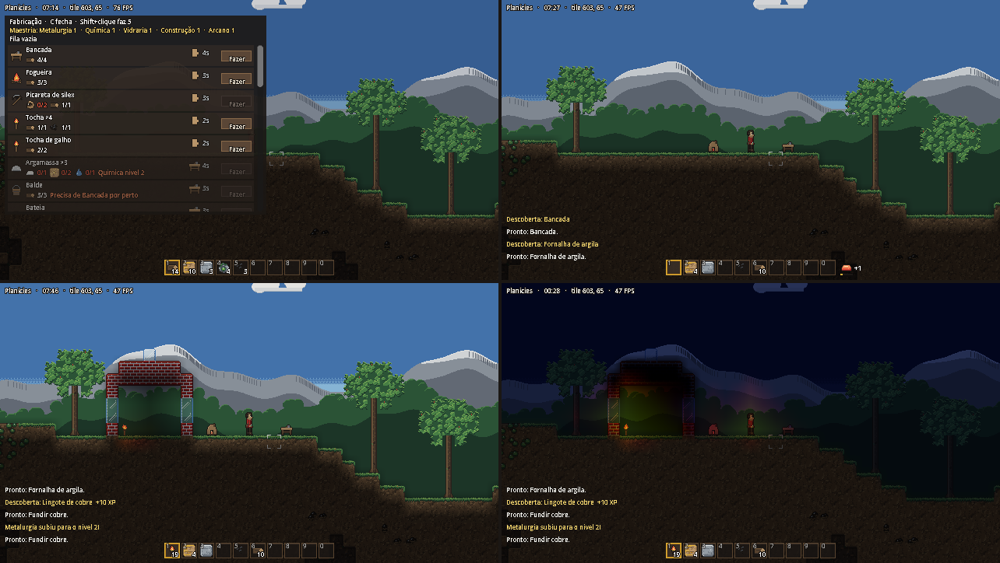

# Arquitetura base

Vitriol roda sempre como **cliente + servidor**, mesmo no solo. No solo, o servidor vive no mesmo processo
(servidor local); no multiplayer, o mesmo código roda num servidor dedicado. Isso evita reescrever o jogo
quando o multiplayer chegar (Onda 10).

```
 Cliente (client/)                     Servidor (core/server/)
 ┌──────────────────┐   comandos    ┌──────────────────────┐
 │ ClientSession    │ ────────────▶ │ GameServer (autoload)│
 │ (tela, entrada)  │               │  WorldState          │
 │                  │ ◀──────────── │  PlayerState         │
 └──────────────────┘    eventos    └──────────────────────┘
          ▲                                   ▲
          └──────── Transport (core/net/) ────┘
                    LocalTransport no solo
                    ENetTransport no multiplayer (Onda 10)
```

## Regras

1. **Só o servidor altera o estado.** O cliente nunca muda o mundo diretamente: ele envia um comando
   (`core/shared/commands.gd`) e reage aos eventos (`core/shared/events.gd`).
2. **Ticks fixos.** O servidor processa os comandos 20 vezes por segundo (`GameServer.TICK_RATE`), na
   ordem de chegada. `step_once()` processa um tick na hora, para testes.
3. **Transporte trocável.** `Transport` é a interface; `LocalTransport` liga cliente e servidor no mesmo
   processo. Um transporte de rede terá a mesma interface.
4. **Estado serializável.** `WorldState` e `PlayerState` expõem `to_dict()`, base para salvar e carregar
   (tarefa 3D) e para enviar estado pela rede.

## Mundo e movimento (Onda 2)

- **O servidor gera o mundo** (`world/world_generator.gd`) a partir de uma semente e o guarda em
  `WorldState.grid`. Ao entrar, o cliente recebe `world_snapshot` (cópia da grade) e depois `joined`.
- **O cliente move o próprio personagem** com `PlayerMotor` e envia `move` 20 vezes por segundo. Esperar
  o servidor a cada passo deixaria o controle travado num jogo de plataforma; é o mesmo modelo do
  Terraria.
- **O servidor confere cada posição** com o mesmo `PlayerMotor`: fora do mundo, dentro de um bloco ou
  rápida demais → manda `correction` com a última posição válida. Aceita → repassa `player_moved` aos
  outros jogadores.
- **Ações que mudam o mundo** são decididas pelo servidor. Minerar: o cliente manda `mine` enquanto o
  botão está apertado; o servidor confere alcance, dureza e ferramenta, conta o tempo, quebra o bloco,
  entrega o item (`inventory`) e avisa todos (`tile_changed`).

## Salvar e carregar (Onda 3)

`core/server/save_game.gd` grava `user://mundos/<nome>/mundo.json`: a grade inteira compactada (tiles e
paredes em zstd + base64, ~80 KB), a paleta de nomes, a hora do dia e os jogadores por nome (posição,
inventário, item selecionado, descobertas). Grava num `.tmp`, mantém a versão anterior como `.bak` e lê o
`.bak` se o principal estiver corrompido. Ao carregar, os tiles são lidos pelo nome: se os dados do jogo
mudarem de ordem, o mundo continua certo. Salva a cada 60 s e ao fechar.

```
Cliente                         Servidor
PlayerMotor.step() a 60 Hz
   └─ move (20 Hz) ───────────▶ confere com PlayerMotor.overlaps_solid()
                                 ├─ ok:    player_moved ─▶ outros clientes
   ◀────────────── correction ──┴─ falha: volta para a última posição válida
```

## Fabricação, maestria e construção (Onda 4)



- **Fabricar** (`craft {receita, qtd}`): o servidor confere estação por perto (raio de 6 blocos,
  `Crafting.stations_near`), nível de maestria, receita secreta e materiais (`Crafting.status`). Os
  materiais saem do inventário na hora e o trabalho entra na fila do jogador (até 20). A cada tick o
  primeiro trabalho anda; pronto, entrega a saída, soma XP e manda `inventory`, `craft_queue` e
  `mastery`. Com o inventário cheio, o item espera na fila. `craft_cancel {index}` devolve os materiais.
- **Maestria** (`core/server/mastery.gd`): XP por área (metalurgia, química, vidraria, construção,
  arcano), níveis 1 a 10 pela tabela `LEVEL_XP`. Receitas com desbloqueio `xp` pedem um nível; as de
  `experimentacao` ficam ocultas (`???`) até a Onda 5. Subir de nível manda um aviso.
- **Construir** (`place {x, y}`): `Building.kind_for` diz se o item vira bloco, objeto ou estação, e
  `Building.placement_problem` diz se cabe: estação precisa de chão; objeto, de chão, bloco ao lado ou
  parede; bloco precisa encostar em algo e não pode prender ninguém. O cliente usa as mesmas funções
  para pintar a moldura do mouse (branca = pode, vermelha = não), mas quem decide é o servidor.
- **Painel** (`client/crafting_panel.gd`, tecla C): mostra todas as receitas por estação, quantos
  materiais tem e faltam, e o motivo do bloqueio. O cliente calcula as estações por perto a cada 0,25 s
  só para mostrar; a contagem regressiva da fila corre no cliente entre um aviso e outro do servidor.
- Vidro é sólido mas **não opaco**: a luz e a parede de fundo aparecem através dele
  (`TileRegistry.is_opaque`).

## Experimentação, cascata e bônus de maestria (Onda 5A)

- `experiment {estacao, itens}`: `Experiment.evaluate` compara o conjunto de materiais com todas as
  receitas da estação. Mesmo conjunto e quantidade suficiente: faz 1 (secreta não conhecida = descoberta,
  XP em dobro). Conjunto certo mas pouco material: pista "proporção". Pistas de quase acerto só apontam
  para receitas secretas ainda não achadas: mesmo conjunto em outra estação ("estação"), conjunto
  menor ("falta"), conjunto maior ("demais"). Errou: gasta 1 de cada material e dá 1 XP na área da
  estação. Resposta no evento `experiment_result`.
- Cascata (`Experiment.cascade`): descobrir um material raro ou acima revela as receitas secretas que o
  usam, desde que os outros materiais não comuns delas já tenham sido descobertos. Exemplo: prata
  sozinha não revela o electro; prata e ouro, sim.
- `mastery` agora leva `receitas` (descobertas) para o painel mostrar as secretas conhecidas.
- Bônus por nível acima do 1: receitas da área 6% mais rápidas (`Mastery.craft_seconds`) e ferramentas
  feitas nela 5% mais duráveis (`durability_for`; o espaço guarda `durabilidade_max`).

## Movimento na construção (Onda 5D)

O jogo é sempre de lado: a casa é um corte e se atravessa por dentro. Cada objeto tem uma `forma`
(itens.csv) que vira `TileRegistry.shape`:

| Forma | Física (`PlayerMotor`) | Luz | Colocação (`Building`) |
| --- | --- | --- | --- |
| porta | não bloqueia quem anda; 2 tiles (`porta` + `porta_alto`) | bloqueia | chão firme e 2 de altura livre |
| plataforma | segura só quem cai de cima; S/↓ atravessa (0,22 s) | passa | ao lado de bloco, porta, escada ou plataforma |
| escada | sobe com pular, desce com S/↓, pendurado não cai; o degrau de cima segura como plataforma | passa | chão, bloco, porta ou outra escada |
| corda | igual à escada | passa | presa em cima ou na beirada; desenrola até 20 tiles |

- A porta abre só no desenho (`WorldView.update_doors`): fica aberta enquanto um jogador encosta. Para
  a física ela nunca bloqueia; as portas com selo do multiplayer (Onda 10) vão bloquear para quem não é
  dono.
- Quebrar qualquer parte da porta ou da corda tira a peça inteira (`Building.piece_from`) e devolve o
  item (`refund_for`: corda = 1 rolo a cada 20 tiles).
- Escada automática: com a escada na mão e pular apertado, o cliente manda `place` com `auto: true`
  para o próximo tile livre no corpo ou logo acima, a cada 0,12 s; o servidor decide e não avisa
  quando não dá.
- Folhas rendem fibra vegetal (34% por folha) ao derrubar a árvore: é o material da corda.

## Pastas por módulo

| Pasta | Conteúdo | Onda |
| --- | --- | --- |
| `core/server/` | GameServer, estado do mundo e dos jogadores | 1 |
| `core/net/` | Transportes cliente ↔ servidor | 1 |
| `core/shared/` | Comandos e eventos (contrato entre cliente e servidor) | 1 |
| `client/` | Cena principal, sessão do cliente, desenho do mundo (`WorldView`), luz, HUD e painel de fabricação | 1–4 |
| `world/` | Grade de tiles, registro de tipos e gerador procedural | 2 (2A) |
| `player/` | Física do personagem (`PlayerMotor`), personagem na tela, comandos de teclado | 2 (2B) |
| `data_loader/` | Autoload `GameData`: dados de jogo de `data/generated/` | 2 (2C) |
| `art/` | Paleta, tiles e sprites | 1 (1D), 2 (2D) |
| `data/` | Esquema, conteúdo (CSV) e dados gerados (JSON) | 1 (1B, 1C) |
| `tools/` | Ferramentas de desenvolvimento (validador de dados) | 1 |
| `tests/` | Testes rodados no Godot em modo headless | 1 |

Cada tarefa paralela mexe só na sua pasta. Mudanças em `core/shared/` (o contrato) devem ser pequenas e
anotadas no STATUS.md, porque afetam todos os módulos.

## Testes

Na primeira vez, importe o projeto (gera o cache de classes):

```
godot --headless --path . --import
godot --headless --path . -s res://tests/run_tests.gd            # todos os testes
godot --headless --path . -s res://tests/run_tests.gd -- mundo   # só os que têm "mundo" no nome
godot --path . -s res://tests/captura.gd -- <pasta>               # roda o jogo e salva prints
godot --headless --path . -s res://world/export_map.gd -- <semente> <saida.png>   # mapa do mundo
```

Os testes ficam em `tests/test_*.gd`; cada método `test_*` é um teste (base em `tests/test_case.gd`).
