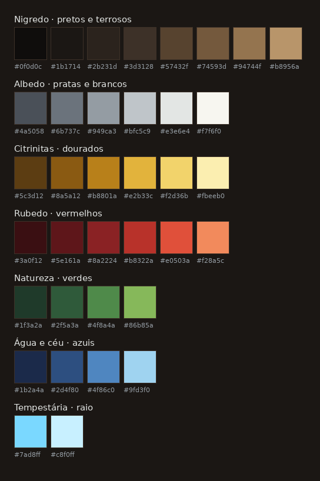
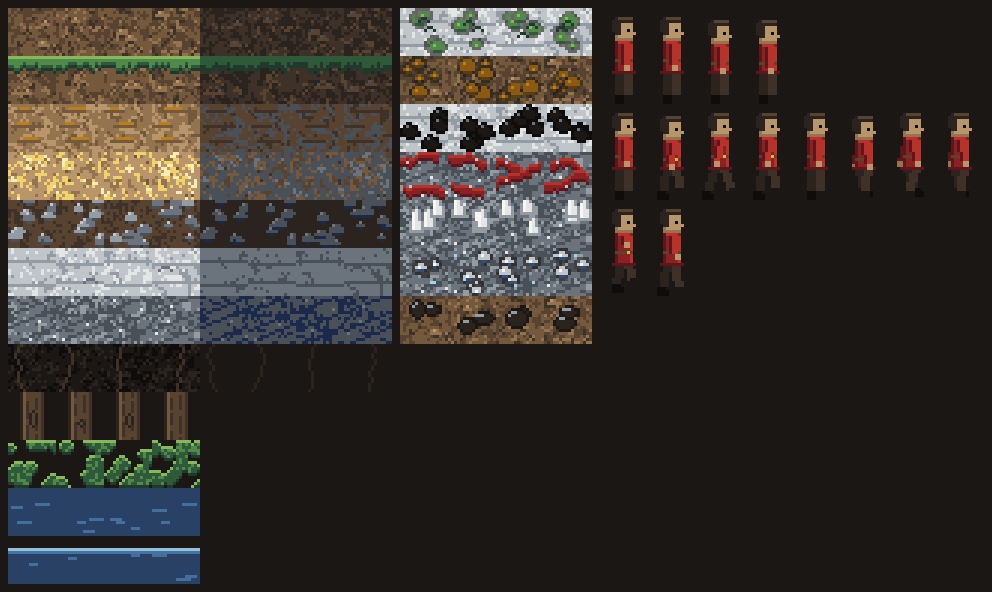

# Guia de arte

Estilo: **pixel art com iluminação dinâmica**. O desenho é simples e econômico; a atmosfera vem da luz
calculada pelo motor (tochas, lava, forja, raios), não de sombras pintadas à mão.

## Grade e resolução

| Item | Valor |
| --- | --- |
| Tile do mundo | 16 × 16 px |
| Ícones de item | 16 × 16 px |
| Personagem | 16 × 32 px (um tile de largura, dois de altura) |
| Resolução interna | 640 × 360 px (40 × 22,5 tiles na tela) |
| Escala na tela | Só inteira: 2× (1280 × 720), 3× (1920 × 1080), 4× (2560 × 1440) |
| Filtro de textura | Nearest (sem suavização) — já configurado no projeto |

## Paleta

36 cores em seis famílias. As quatro primeiras seguem as fases da Grande Obra e dão a cor de cada camada.

Arquivos em `art/paleta/`: `vitriol.gpl` (GIMP e Aseprite), `vitriol.hex` (Lospec e outros) e
`vitriol.png` (tira de 1 px por cor).

| Família | Uso |
| --- | --- |
| Nigredo (pretos e terrosos) | Camadas Solo e Sedimentar, contornos, madeira, terra |
| Albedo (pratas e brancos) | Camada Metamórfica, metais claros, pedra fria |
| Citrinitas (dourados) | Cavernas de Magma, ouro, bronze, luz de tocha |
| Rubedo (vermelhos) | Núcleo Cristalino, lava, fogo, cobre aquecido |
| Natureza (verdes) | Vegetação das Planícies, malaquita |
| Água e céu (azuis) | Água, céu, sombras frias |
| Tempestária | Raio, fulgurito, vidro de tempestade — reservadas à magia |

As duas cores da Tempestária só aparecem em magia. Isso faz o jogador reconhecer um efeito mágico pela
cor, sem ler nada.

## Regras de pixel art

1. **Sem anti-aliasing automático** e sem rotação ou escala fracionada de sprites.
2. **Contorno colorido, não preto puro.** Use `#1b1714` ou o tom mais escuro do próprio material.
3. **Luz desenhada vem de cima.** A luz dinâmica do motor complementa, não substitui.
4. **De 3 a 5 tons por material.** Mais que isso vira ruído em 16 px.
5. **Sombra puxa para o frio, luz puxa para o quente** (hue shifting): o metal fica mais vivo do que só
   escurecer o mesmo tom.
6. **Tiles com autotile** no padrão de terreno do Godot (3 × 3 mínimo, 47 variações), para as bordas se
   ajustarem sozinhas.
7. **Cada material tem silhueta própria.** Minérios se distinguem pela forma dos veios, não só pela cor
   (acessibilidade para daltonismo).

## Personagem em partes

O personagem é montado em camadas sobrepostas do mesmo tamanho (16 × 32 px). Trocar uma parte não exige
redesenhar as outras, e o equipamento aparece por cima do corpo.

| Ordem (de trás para frente) | Camada | Varia por |
| --- | --- | --- |
| 1 | Braço de trás | Pele, roupa |
| 2 | Pernas | Pele, calça, bota |
| 3 | Tronco | Roupa |
| 4 | Cabeça e rosto | Pele, rosto |
| 5 | Cabelo | Corte, cor |
| 6 | Armadura | Material (cobre, bronze, aço, draconito…) |
| 7 | Braço da frente e ferramenta | Ferramenta na mão |
| 8 | Efeito de ressonância | Escola ativa (faíscas, brasas…) |

Animações do MVP, com o mesmo número de quadros em todas as camadas:

| Animação | Quadros |
| --- | --- |
| Parado | 4 |
| Andar | 8 |
| Pular (subida e queda) | 2 |
| Minerar | 4 |
| Fabricar | 4 |

## Iluminação

Cada camada tem uma luz ambiente; quanto mais fundo, mais escuro, até as cavernas dependerem só das fontes
de luz. Valores iniciais, a ajustar no teste de jogo:

| Lugar | Luz ambiente |
| --- | --- |
| Superfície de dia | 100% |
| Superfície à noite | 35%, azulada (`#1b2a4a`) |
| Camada Solo | 45% |
| Camada Sedimentar | 20% |
| Camada Metamórfica | 8% |

| Fonte de luz | Cor | Alcance | Comportamento |
| --- | --- | --- | --- |
| Tocha | `#e2b33c` | 6 tiles | Tremula levemente |
| Fogueira | `#f28a5c` | 7 tiles | Tremula |
| Fornalha acesa | `#e0503a` | 5 tiles | Pulsa quando está fundindo |
| Lava | `#e0503a` | 4 tiles | Constante |
| Raio | `#c8f0ff` | 20 tiles | Clarão de 0,15 s |
| Fulgurito e vidro de tempestade | `#7ad8ff` | 2 tiles | Pulso lento |

No Godot: `CanvasModulate` para a luz ambiente de cada camada e `PointLight2D` para cada fonte, com sombras
2D ligadas nos tiles sólidos.

## Arte gerada por código (Onda 2)

A arte base é gerada por `tools/art/gerar_arte.py`, só com cores da paleta (o script recusa qualquer cor
fora dela). Rodar de novo gera os mesmos arquivos.

| Arquivo | Conteúdo |
| --- | --- |
| `art/tiles/tiles.png` | Uma linha por tile: colunas 0–3 são variações da frente, 4–7 a parede de fundo |
| `art/tiles/minerios.png` | Minérios com fundo transparente, desenhados **por cima da rocha** da camada |
| `art/tiles/bordas.png` | 16 máscaras de borda: contorno e brilho onde o bloco encosta no ar |
| `art/personagem/*.png` | Uma folha por parte do corpo, 16 × 32 por quadro |

Por que assim:

- **Minério sobre a rocha:** malaquita no calcário tem fundo de calcário; no Solo, fundo de terra. Um
  desenho por minério serve para qualquer camada.
- **Bordas automáticas:** em vez de 47 variações de autotile por material, uma camada de bordas por cima
  dá o contorno. Cantos arredondados ficam para o polimento.
- **Formas distintas por minério:** faixas (hematita), prismas (quartzo), grãos redondos (prata), lascas
  (carvão), manchas concêntricas (malaquita).

Animações prontas: parado (4), andar (8), pular (2). Minerar e fabricar entram com as ações (Ondas 3 e 4).

## Referências de estilo

- **Terraria:** escala de tiles e personagem, leitura clara dos blocos.
- **Noita:** luz e partículas reagindo aos materiais.
- **Core Keeper:** escuridão de caverna recortada pela luz das tochas.

Usar como referência de linguagem visual; nenhuma arte desses jogos entra no projeto.
